# FixIt architecture

A high-level map of how FixIt is built, then a review of the architecture: what's solid,
what's weak, and what to improve first. GitHub draws the diagrams below automatically.

## 1. The big picture

Three kinds of people use one web app. The app talks to one API, which keeps everything
in PostgreSQL and asks OpenStreetMap where addresses are.

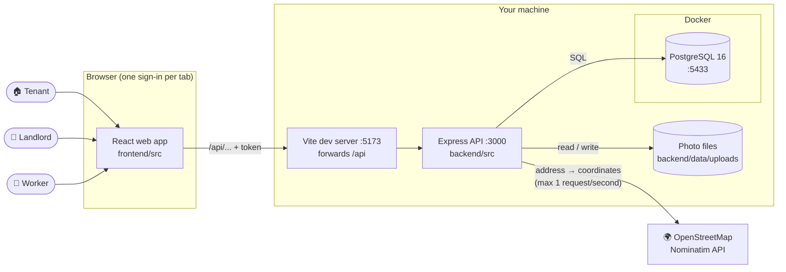

## 2. Inside the backend: layers

Each layer only talks to the one below it. Only `models/` runs SQL: that's the
"repository layer" from the Week 1 brief.

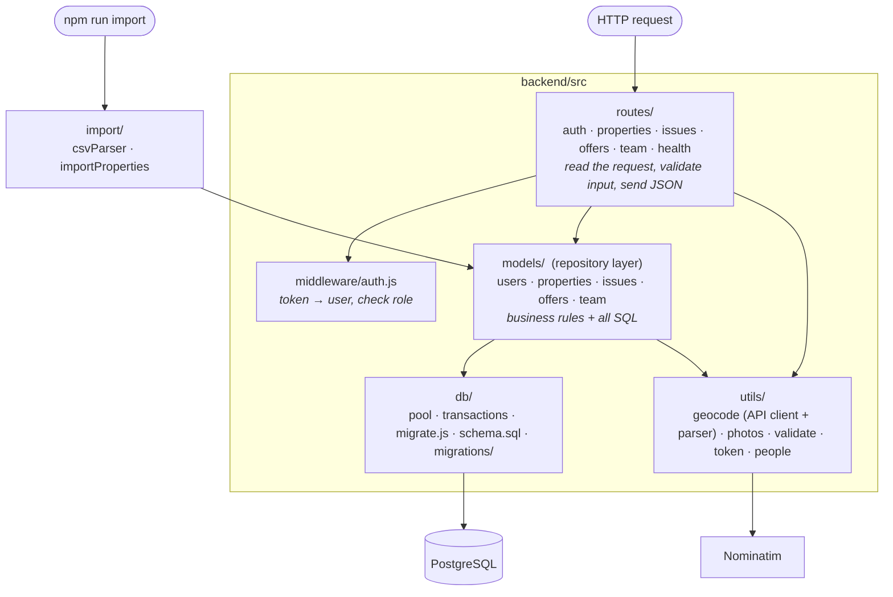

## 3. Inside the frontend

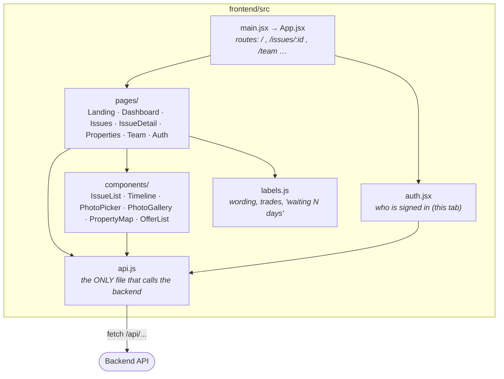

## 4. One request, end to end: a tenant reports a leak with a photo

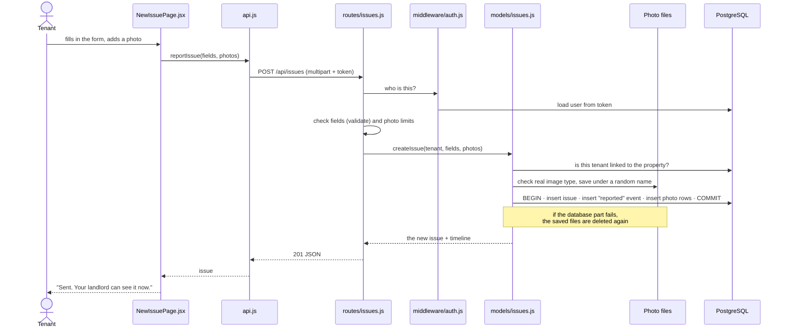

## 5. The life of an issue

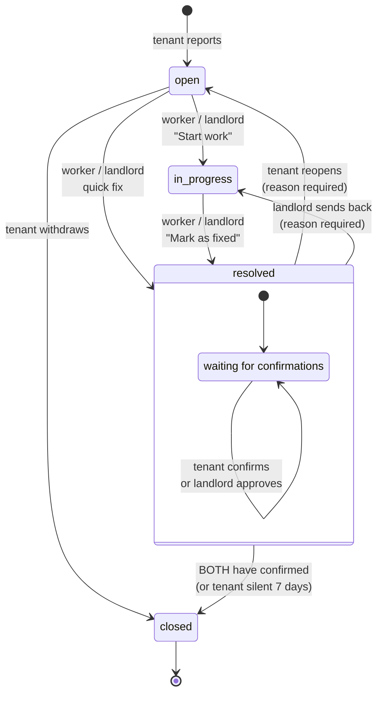

## 6. Getting a worker: job offers

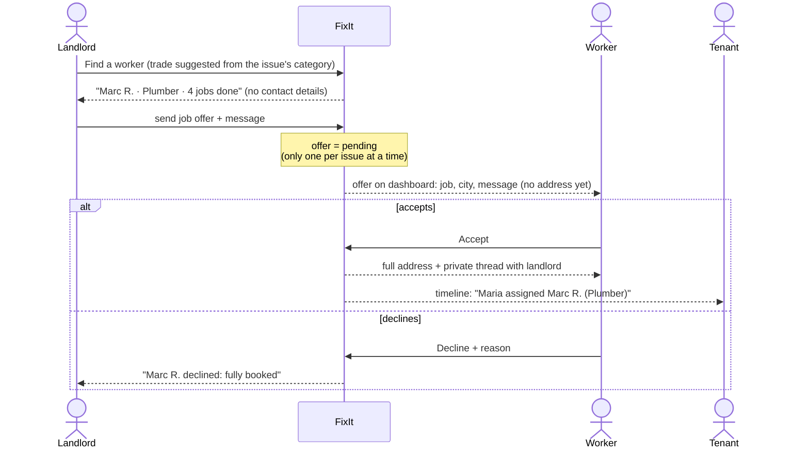

## 7. Data model

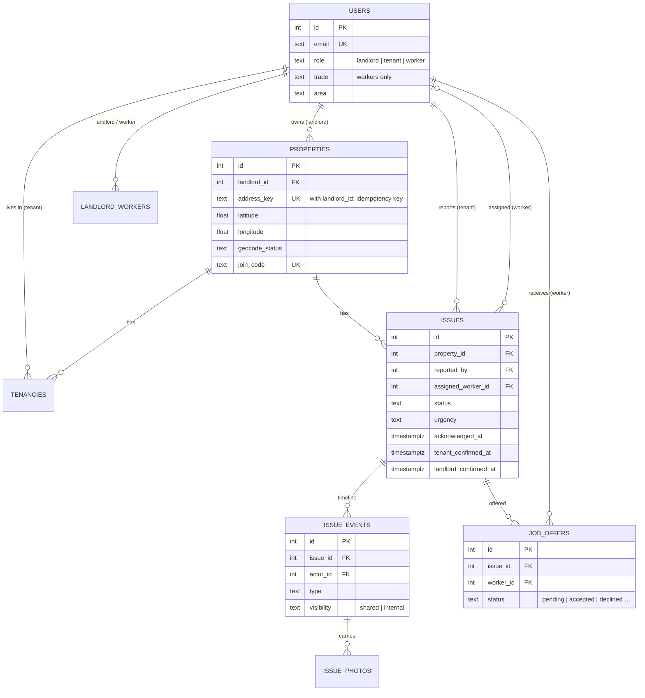

## 8. The Week 1 import pipeline

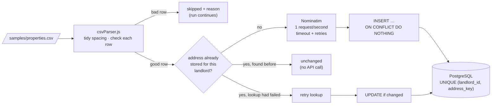

---

# Architecture review

## What's solid

| Practice | Where |
| --- | --- |
| **Clear layers** with one job each; only `models/` touches SQL; only `api.js` calls the backend | backend/src, frontend/src/api.js |
| **The database defends itself**: CHECK constraints, foreign keys, unique keys (one pending offer per issue, one address per landlord) | db/schema.sql, migrations/002 |
| **Safe schema changes**: numbered migrations, each in a transaction, advisory lock against two processes migrating at once | db/migrate.js |
| **Atomic changes**: every status change and its timeline entry in one transaction; `FOR UPDATE` row locks stop two people "closing" an issue at once | models/issues.js |
| **Access rules written once**, as SQL (`visibleTo`), and other people's data is a 404, not a 403 | models/issues.js, models/properties.js |
| **Resilient external API use**: timeouts, retries with backoff, 1 req/s, no retry on 403, a failed lookup never blocks adding a property | utils/geocode.js |
| **Careful uploads**: real file type checked from bytes, random file names, files cleaned up if the database write fails, photos only served to people allowed to see them | utils/photos.js |
| **Tests against real PostgreSQL**, each file in a throwaway schema | backend/test/helpers.js |
| **Secrets out of git**, `.env.example` documents them | .gitignore |

## Weak parts, most important first

### 🔴 High: fix before real users

1. **No protection against password guessing.** `/api/auth/login` and
   `/api/properties/join` accept unlimited attempts. Someone can try thousands of
   passwords, or guess join codes (8 characters from 31 is about 850 billion
   combinations, which is large but not unreachable without limits).
   → Add `express-rate-limit` on login, register and join, e.g. 10 attempts per
   15 minutes per IP and per email.

2. **Anyone can become a landlord and browse every worker.** Sign-up is open and
   unverified, and the directory lists all workers' first names, trades and areas to
   any landlord account. Offers could be used to spam workers.
   → Verify emails before an account can send offers; limit offers per landlord per day;
   let workers choose whether they're listed in the directory.

3. **No security headers on the API**, and the sign-in token is readable by JavaScript.
   The token in `sessionStorage` would be stolen by any cross-site scripting bug.
   → Add `helmet` (security headers, Content-Security-Policy). For production, move the
   token to an `httpOnly`, `SameSite` cookie, which JavaScript can't read.

4. **No way to recover an account**: no password reset or email change. A forgotten
   password means a lost account, with all its properties and history.
   → Email-based reset with a short-lived single-use token.

### 🟠 Medium: architecture that won't scale

5. **Lists have no pagination.** `listIssuesFor` and `listPropertiesFor` return
   everything, and `summaryFor` loads **every** issue just to count them in JavaScript
   (models/issues.js, `summaryFor`). Fine for 50 issues, slow for 50,000.
   → `LIMIT/OFFSET` (or cursor) pagination on lists; compute the summary with one SQL
   `count(*) FILTER (WHERE …)` query.

6. **Slow work happens inside the request.** Adding a property waits for OpenStreetMap,
   up to about 40 s with retries in the worst case, while the user stares at a spinner.
   And the 1 request/second limit lives in the API's memory, so two API instances would
   send 2 requests/second and break Nominatim's policy.
   → Save the property immediately with `geocode_status = 'pending'`, and geocode in a
   background job (a simple Postgres-backed queue such as `pg-boss`), with a shared
   rate limit.

7. **Photos live on the API server's disk.** They aren't in database backups, and a
   second server, or a redeployed container without the volume, wouldn't have them.
   → Object storage (S3, Cloudflare R2, MinIO in Docker locally), served through
   short-lived signed URLs.

8. **Nobody gets told anything.** No email or push: a tenant only sees "Marc accepted"
   when they open the app, and **job offers never expire**, so a forgotten offer blocks
   the issue (only one pending offer is allowed).
   → Email notifications for offers, assignments and "please confirm"; give offers an
   `expires_at` (e.g. 48 h) so the landlord can move on.

9. **Rules shared by frontend and backend are copied by hand.** The trade list exists in
   3 places (utils/people.js, frontend labels.js, the migration's CHECK) and the photo
   limits in 2. They will drift apart.
   → A small shared package (or `GET /api/meta`) as the single source; or generate the
   frontend constants from the backend.

10. **"Models" do two jobs.** They hold business rules *and* SQL, and `offers.js`
    reaches into `issues.js` internals (`requireIssueAccess`, `markTouched`). It works,
    but `issues.js` (452 lines) and `IssueDetailPage.jsx` (439 lines) are becoming the
    files everyone has to edit.
    → Split into `services/` (rules: who may do what) and `repositories/` (SQL only);
    split `IssueDetailPage` into its panels (one file each).

### 🟡 Low: engineering hygiene

11. **No CI.** Tests only run when someone remembers. → A GitHub Actions workflow that
    starts Postgres and runs both test suites on every push.
12. **No linter or formatter**, although the code contains `eslint-disable` comments.
    → ESLint + Prettier, run in CI.
13. **Logging is `console.log`**, with no request ids or levels, so production problems
    are hard to trace. → A structured logger (`pino`) with a request id per request.
14. **The timeline is append-only by convention only.** Nothing stops a future bug, or a
    manual SQL session, from editing history. → A trigger that rejects `UPDATE` and
    `DELETE` on `issue_events`.
15. **`npm run seed -- --reset` empties every table without asking.** One wrong
    terminal and the data is gone. → Refuse unless `NODE_ENV=development`, and ask for
    confirmation.
16. **No production setup for the frontend.** Vite's dev server does the `/api`
    forwarding; there's no production equivalent yet. → Serve the built `dist/` from the
    API (Express static) or behind nginx, under one origin.
17. **No browser tests.** Unit and API tests are strong, but nothing clicks through the
    real app. → A few Playwright tests for the main journey (report → offer → accept →
    fix → confirm).

## Roadmap: what to fix and in which order

### Every weak part and its fix

| # | Weak part | Fix | Phase |
| --- | --- | --- | --- |
| 1 | Unlimited login / join-code attempts | `express-rate-limit` per IP and per email | 1 |
| 2 | Open, unverified sign-up; directory open to any landlord | email verification before sending offers; directory opt-in; daily offer limit | 1, 2 |
| 3 | No security headers; token readable by JavaScript | `helmet` + CSP; refresh token in an `httpOnly` cookie ([design](#planned-safer-accounts)) | 1 |
| 4 | No password reset | emailed single-use reset link (needs email sending) | 1 |
| 5 | No pagination; summary loads every issue | `LIMIT` + cursor; one `count(*) FILTER (…)` query | 2 |
| 6 | Geocoding inside the request; rate limit per process | `pg-boss` background job with one shared limit | 3 |
| 7 | Photos on the server's disk | S3 / R2 (MinIO locally), signed links | 3 |
| 8 | No notifications; offers never expire | email notifications; `expires_at` on offers | 2 |
| 9 | Trades and limits copied in 3 places | one shared source (`GET /api/meta` or a shared module) | 0 |
| 10 | Models mix rules and SQL; huge files | `services/` + `repositories/`; split `IssueDetailPage` | 3 |
| 11 | No CI | GitHub Actions with a Postgres service | 0 |
| 12 | No linter / formatter | ESLint + Prettier in CI | 0 |
| 13 | `console.log` logging | `pino` + request ids | 3 |
| 14 | Timeline append-only only by convention | trigger rejecting `UPDATE`/`DELETE` on `issue_events` | 0 |
| 15 | `seed --reset` empties everything unasked | development only + confirmation | 0 |
| 16 | No production frontend setup | API serves `dist/`, one origin, HTTPS | 3 |
| 17 | No browser tests | Playwright for the main journey | 3 |
| new | Paying workers | Stripe Connect ([design](#planned-landlords-pay-workers-with-stripe-connect)) | 4 |

### The revised order

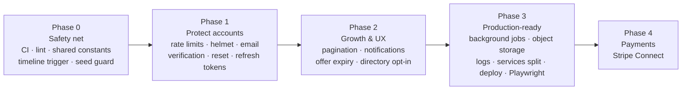

What changed from the first suggestion, and why:
- **Email sending moved into Phase 1.** Email verification, password reset *and*
  notifications all need it, so it's built once, early.
- **Shared constants and the timeline trigger moved to Phase 0.** They're small, and
  every later phase adds trades, statuses or timeline entries that depend on them.
- **The services/repositories split comes before payments.** Money rules ("who may pay
  whom, when") need a clear home, not another 100 lines in `issues.js`.
- **Payments come last.** They need verified accounts (Phase 1), a public HTTPS server
  for Stripe's webhooks, and background jobs to process them (Phase 3).

## Planned: safer accounts

**Keep JWT, but use it the way it's meant to be used:** short-lived, with a revocable
refresh token. Today a 7-day token sits in `sessionStorage`, where any cross-site
scripting bug could read it, and it can't be revoked before it expires.

| | Today | Planned |
| --- | --- | --- |
| Access token | JWT, 7 days, in `sessionStorage` | JWT, **15 minutes**, in memory only |
| Staying signed in | the same 7-day token | **refresh token** in an `httpOnly` + `Secure` + `SameSite` cookie (JavaScript can't read it) |
| Log out / stolen token | wait up to 7 days | delete the refresh token: **revoked at once**, everywhere |
| Reuse detection | none | refresh tokens rotate on every use; reusing an old one revokes the whole family |
| Password guessing | unlimited | rate limited; optional TOTP two-factor for landlords and workers |

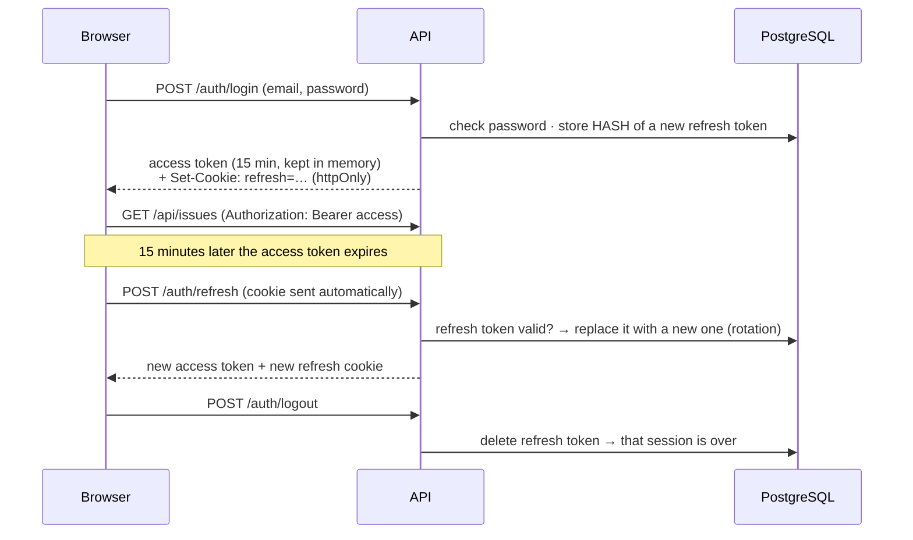

New table: `refresh_tokens (id, user_id, token_hash, family_id, expires_at, revoked_at,
user_agent)`. Because the frontend and API will be served from one origin, the cookie
works without CORS. `SameSite=Strict` plus an `Origin` header check covers CSRF.

> A managed auth service (Auth0, Clerk, Supabase Auth) would do all of this for you. It's
> worth considering for production; building it yourself first teaches how it works.

## Planned: landlords pay workers with Stripe Connect

FixIt becomes a **marketplace**: money goes from a landlord, through the platform, to a
worker. That's exactly what **Stripe Connect** is for:
- each worker gets an **Express connected account**;
- Stripe checks their identity, holds their bank details and pays them out;
- FixIt stores only Stripe's ids, never card or bank details.

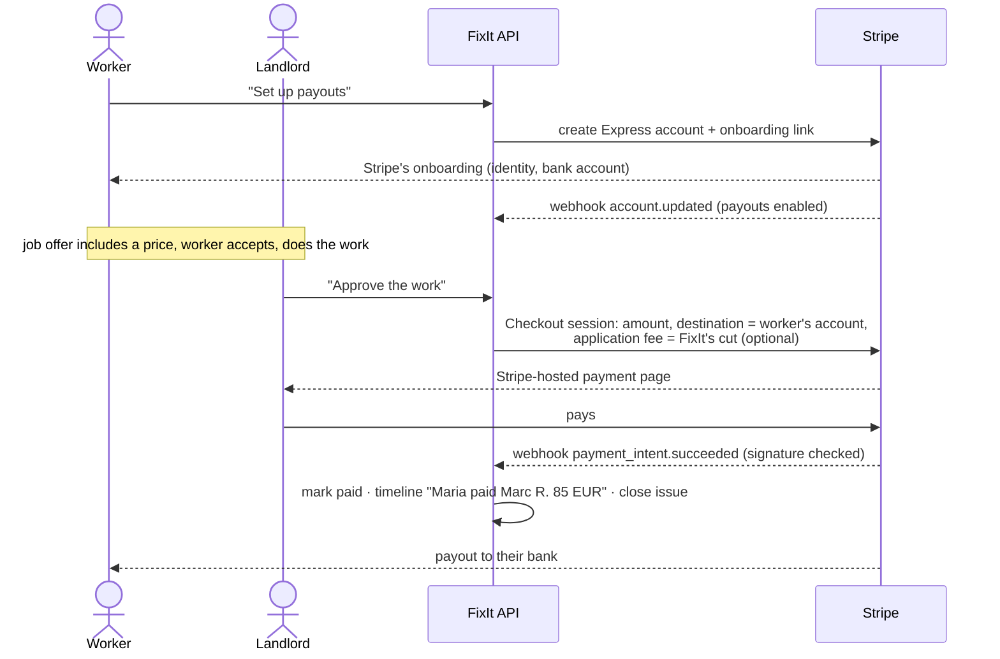

Data to add:
- `users.stripe_account_id` and `users.payouts_enabled` for workers;
- `job_offers.amount_cents` and `currency`;
- a `payments` table: `issue_id`, `landlord_id`, `worker_id`, `amount_cents`,
  `platform_fee_cents`, `status`, `stripe_payment_intent_id` (unique), `created_at`.

Rules that matter:
- **The webhook is the truth.** A payment counts only when Stripe's signed webhook says
  it succeeded, never because the browser was redirected to a "thank you" page.
- **Idempotency:** a unique `stripe_payment_intent_id`, plus Stripe idempotency keys, so a
  retried webhook or a double click never pays twice.
- **Amounts are integers in cents**, in one currency per payment, computed on the server.
- **Test mode first**, with `stripe listen --forward-to localhost:3000/api/stripe/webhook`.
- **Later, escrow-style:** charge when the offer is accepted, transfer when both confirm
  ("separate charges and transfers"). This matches FixIt's two-sided confirmation, but
  it needs refund and dispute handling designed first.
